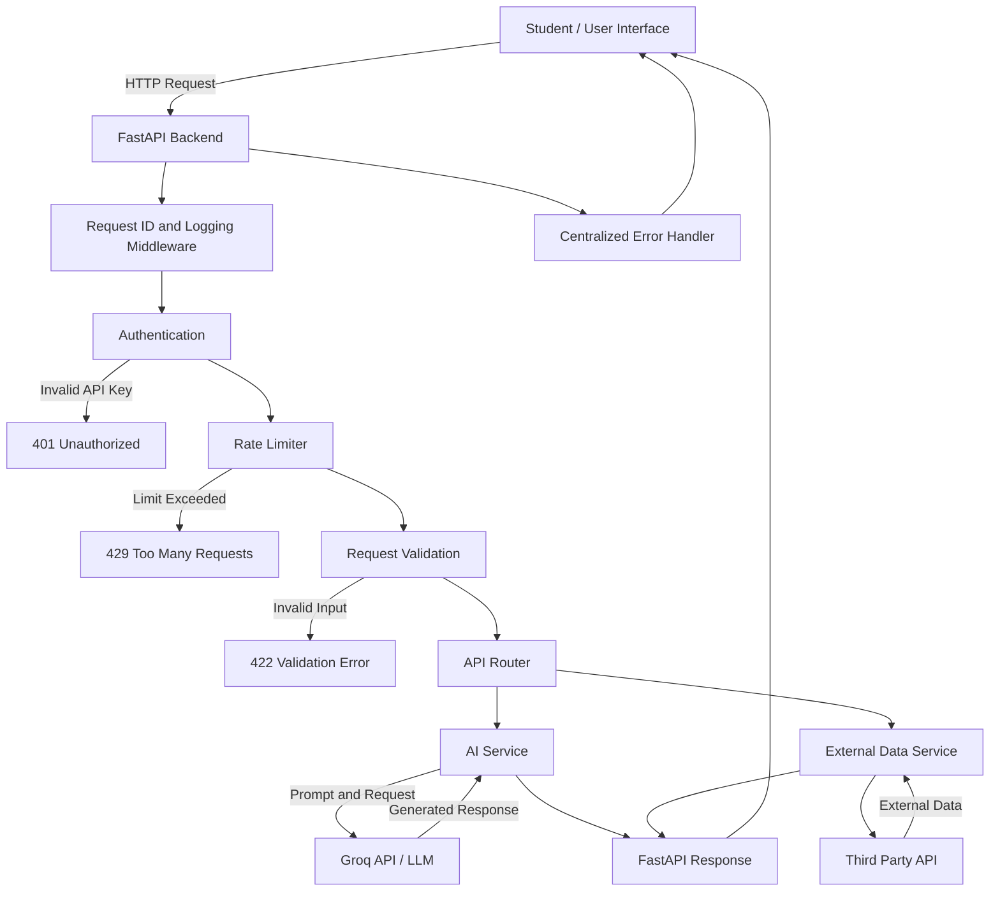

# CampusAssist AI - System Architecture

## 1. Architecture Overview

CampusAssist AI is an AI-powered backend application
developed using FastAPI and Groq API.

## 2. Architecture Diagram

## 3. Major Request/Response Flows

### AI Request Flow

1. Student submits a question.
2. FastAPI receives the request.
3. Middleware generates a request ID.
4. Authentication validates the API key.
5. Rate limiter checks request frequency.
6. Pydantic validates the request.
7. AI service sends the prompt to Groq.
8. Groq generates the response.
9. FastAPI returns the response to the user.

### External Data Flow

1. User requests external information.
2. FastAPI receives the request.
3. Authentication and rate limiting are checked.
4. External data service calls a third-party API.
5. Third-party API returns data.
6. Backend returns the required information.

## 4. Possible Error Locations

| Component | Possible Error | HTTP Status |
|---|---|---|
| Authentication | Invalid API key | 401 |
| Rate Limiter | Too many requests | 429 |
| Validation | Invalid request | 422 |
| AI Service | Groq timeout | 504 |
| AI Service | Groq provider failure | 502 |
| External API | External service timeout | 504 |
| External API | External service failure | 502 |
| Backend | Unexpected error | 500 |

## 5. Security and Monitoring

- API keys will be stored in environment variables.
- Authentication will protect AI endpoints.
- Rate limiting will control request frequency.
- Request IDs will help trace requests.
- Logs will capture status, latency and error types.
- Sensitive credentials will never be logged.
